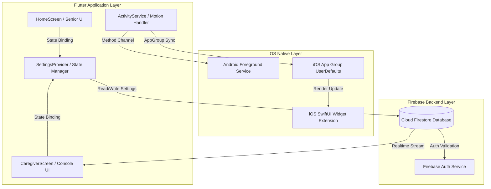
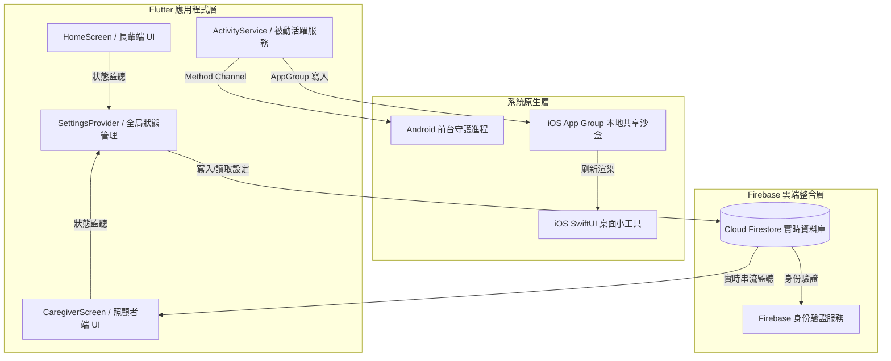

# Software Design Specification (SDS) - PNCC關懷 / dailyNotify
## 軟體設計規格說明書 - PNCC關懷 / dailyNotify

---

# Part 1: English Version (英文版)

## 1. System Architecture
The application is built on a decoupled, cross-platform architecture utilizing Flutter for the frontend interfaces, native platform extensions (Swift/Kotlin) for widgets and background motion tracking, and Cloud Firestore for low-latency real-time synchronization.

### 1.1 Architecture Blueprint


---

## 2. Database Design (Firestore Collection Schema)

### 2.1 `users` Collection
Each document stores the metadata, safety status, and configuration settings of a registered user.
```json
{
  "uid": "String (Document ID)",
  "displayName": "String",
  "phoneNumber": "String",
  "whatsappNumber": "String",
  "lineId": "String",
  "wechatId": "String",
  "preferredContactMethod": "String ('phone' | 'sms' | 'whatsapp' | 'line' | 'wechat')",
  "role": "String ('senior' | 'caregiver')",
  "lastActive": "Timestamp",
  "updatedAt": "Timestamp",
  "checkInFrequencyMinutes": "Integer",
  "alertTimeoutMinutes": "Integer",
  "escalateToEmergencyServices": "Boolean",
  "escalationTimeoutMinutes": "Integer",
  "pauseStartDate": "Timestamp (Nullable)",
  "pauseEndDate": "Timestamp (Nullable)",
  "resetRequested": "Boolean",
  "resetRequestedAt": "Timestamp (Nullable)",
  "resetRequestedBy": "String (Caregiver UID)"
}
```

### 2.2 `alerts` Collection
Fired automatically when a safety timer expires or fall is detected.
```json
{
  "alertId": "String (Document ID)",
  "seniorId": "String (Indexed)",
  "seniorName": "String",
  "message": "String",
  "type": "String ('timeout' | 'fall')",
  "status": "String ('triggered' | 'acknowledged')",
  "createdAt": "Timestamp",
  "acknowledgedAt": "Timestamp (Nullable)",
  "acknowledgedBy": "String (Caregiver UID)"
}
```

### 2.3 `care_groups` Collection
Stores relationship mapping between seniors and caregivers.
```json
{
  "groupId": "String (Document ID)",
  "name": "String",
  "ownerId": "String (Senior UID)",
  "caregiverIds": "Array of Strings (Caregiver UIDs)",
  "createdAt": "Timestamp"
}
```

---

## 3. Native Platform Integration (Method Channels)

### 3.1 App Control & Background Operations
- **Channel Name**: `daily_notify/app_control`
  - **Method**: `minimizeApp`
  - **Description**: Automatically pops the app out of view and returns the user to the device's home screen after a successful check-in.
- **Channel Name**: `daily_notify/caregiver_widget`
  - **Method**: `updateWidgetData`
  - **Payload**: JSON String of paired seniors' names and statuses.
  - **Implementation**: Writes directly to iOS Shared UserDefaults under App Group suite `group.com.example.dailyNotify` and calls `WidgetCenter.shared.reloadAllTimelines()`.

---

## 4. UI/UX Design System Specification
To achieve a premium, trustworthy look and feel, we utilize the following theme palette and glassmorphism specs:

### 4.1 Theme Colors
- **Primary Blue (Trust & Security)**: `Colors.blue.shade900` (`#0D47A1`)
- **Safe Green**: `Colors.green.shade600` (`#43A047`)
- **Warning Yellow/Amber**: `Colors.orange.shade700` (`#F57C00`)
- **Danger Red**: `Colors.red.shade600` (`#E53935`)
- **Paper Beige (Scripture background)**: `#FDFBF7`

### 4.2 Card Design Specs (Glassmorphism)
- **Background**: `White.withOpacity(0.55)` with `BackdropFilter(filter: ImageFilter.blur(sigmaX: 10, sigmaY: 10))`
- **Border**: `Border.all(color: White.withOpacity(0.3))`
- **Shadow**: Light shadow offset `(0, 6)` with `25%` opacity.

---
---

# Part 2: Chinese Version (中文版)

## 1. 系統架構設計
本系統採用高內聚、低耦合的跨平台架構設計。前端界面主要採用 Flutter 進行開發，系統底層與小工具通訊採用原生代碼（Swift/Kotlin）進行整合，雲端則依賴 Firebase 進行低延遲、高實時的數據同步。

### 1.1 架構設計藍圖


---

## 2. 資料庫模型設計 (Firestore 數據結構)

### 2.1 `users` 集合 (用戶檔案與設定)
每個文檔對應一個註冊用戶（長輩或照顧者）的基本設定與活躍指標。
```json
{
  "uid": "String (文檔 ID)",
  "displayName": "String (顯示名稱)",
  "phoneNumber": "String (電話)",
  "whatsappNumber": "String (WhatsApp 號碼)",
  "lineId": "String (Line ID)",
  "wechatId": "String (WeChat ID)",
  "preferredContactMethod": "String ('phone' | 'sms' | 'whatsapp' | 'line' | 'wechat')",
  "role": "String ('senior' | 'caregiver')",
  "lastActive": "Timestamp (最後活躍時間戳)",
  "updatedAt": "Timestamp (最後更新時間戳)",
  "checkInFrequencyMinutes": "Integer (回報頻率 - 分鐘)",
  "alertTimeoutMinutes": "Integer (報警寬限期 - 分鐘)",
  "escalateToEmergencyServices": "Boolean (是否自動撥打救援服務)",
  "escalationTimeoutMinutes": "Integer (救援超時時間)",
  "pauseStartDate": "Timestamp (暫停開始日期, 可為空)",
  "pauseEndDate": "Timestamp (暫停結束日期, 可為空)",
  "resetRequested": "Boolean (是否請求遠端重置計時器)",
  "resetRequestedAt": "Timestamp (遠端重置請求時間, 可為空)",
  "resetRequestedBy": "String (操作的照顧者 UID)"
}
```

### 2.2 `alerts` 集合 (警報觸發記錄)
當長輩未能在寬限期內回報，或發生跌倒時，會在此集合中創建一條即時記錄。
```json
{
  "alertId": "String (文檔 ID)",
  "seniorId": "String (長輩 UID, 已建立索引)",
  "seniorName": "String (長輩姓名)",
  "message": "String (警報消息說明)",
  "type": "String ('timeout' | 'fall')",
  "status": "String ('triggered' | 'acknowledged')",
  "createdAt": "Timestamp (觸發時間)",
  "acknowledgedAt": "Timestamp (確認處理時間, 可為空)",
  "acknowledgedBy": "String (操作的照顧者 UID)"
}
```

### 2.3 `care_groups` 集合 (關懷群組映射)
儲存受照護長輩與其對應照顧者之間的配對關係。
```json
{
  "groupId": "String (文檔 ID)",
  "name": "String (群組名稱)",
  "ownerId": "String (長輩 UID)",
  "caregiverIds": "Array of Strings (所有綁定的照顧者 UID)",
  "createdAt": "Timestamp (建立時間)"
}
```

---

## 3. 系統原生底層通訊規格 (Method Channels)

### 3.1 系統層控與桌面工具通訊
- **通道名稱**：`daily_notify/app_control`
  - **方法名稱**：`minimizeApp`
  - **用途**：長輩成功按下「我很好」報平安後，Flutter 發出通訊，呼叫 OS 底層自動將 App 收縮至後台背景，恢復桌面狀態。
- **通道名稱**：`daily_notify/caregiver_widget`
  - **方法名稱**：`updateWidgetData`
  - **數據格式**：JSON 字串（包含受照護長輩的名單及對應狀態代碼）。
  - **技術原理**：直接寫入 iOS 共享 UserDefaults（套件組：`group.com.example.dailyNotify`），隨後發送通知 `WidgetCenter.shared.reloadAllTimelines()` 強制刷新桌面小工具。

---

## 4. UI/UX 視覺與設計系統規範
為長者提供高信賴度且兼顧現代設計美學的視覺系統。

### 4.1 系統配色規範
- **品牌深藍 (守護與穩重)**：`Colors.blue.shade900` (`#0D47A1`)
- **安全守護綠 (Safe)**：`Colors.green.shade600` (`#43A047`)
- **黃金提醒橙 (Grace Period)**：`Colors.orange.shade700` (`#F57C00`)
- **警示危險紅 (Danger / Expired)**：`Colors.red.shade600` (`#E53935`)
- **心靈宣紙色 (經文紙張底色)**：`#FDFBF7`

### 4.2 毛玻璃卡片設計規範 (Glassmorphism)
- **背景填充**：`White.withOpacity(0.55)` 疊加背景濾鏡 `BackdropFilter(filter: ImageFilter.blur(sigmaX: 10, sigmaY: 10))`
- **邊框描邊**：`Border.all(color: White.withOpacity(0.3))`
- **陰影效果**：羽化值 `15` 的輕量陰影，垂直偏移 `6`，不透明度 `25%`。

---
